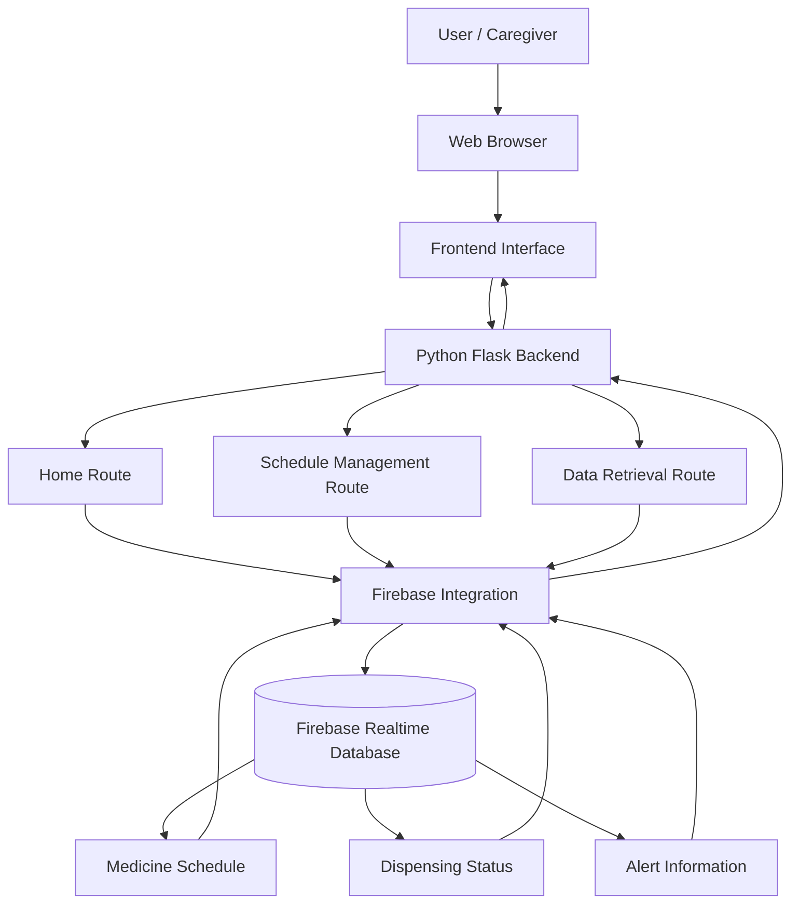
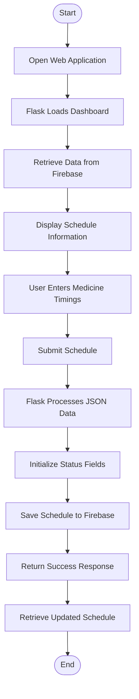

# Smart Pill Dispenser System

## 📌 Project Overview

The **Smart Pill Dispenser System** is a medicine schedule management application developed using Python Flask and Firebase Realtime Database.

The system provides a web-based interface through which users can manage medicine schedules and maintain dispensing status information. Firebase is used as the cloud database to store and retrieve medicine schedules and alert-related data.

The application is designed to support organized medicine schedule management and provide a foundation for a smart medication dispensing solution.

## 🏗️ System Architecture

The project follows a three-layer architecture:

1. **Presentation Layer:** HTML, CSS, and JavaScript provide the user interface.
2. **Application Layer:** Python Flask handles HTTP requests, schedule processing, and database communication.
3. **Database Layer:** Firebase Realtime Database stores medicine schedules, dispensing status, and alert information.

### Architecture Diagram



## 🛠️ Technologies Used

| Technology | Purpose |
|---|---|
| Python | Backend programming |
| Flask | Web application framework |
| HTML | Frontend structure |
| CSS | Frontend styling |
| JavaScript | Frontend interactions |
| Firebase Realtime Database | Cloud database |
| Pyrebase4 | Firebase integration |
| Firebase Admin SDK | Administrative Firebase integration |

## ⚙️ System Implementation

### 1. Frontend Development
- Provides the web interface for interacting with the application.
- Allows users to enter and manage medicine schedules.
- Displays information retrieved from the backend.

### 2. Backend Development
The Flask application manages the communication between the frontend and Firebase.

Three main routes are implemented:

| Endpoint | HTTP Method | Description |
|---|---|---|
| `/` | GET | Loads the main dashboard and retrieves stored data. |
| `/set_schedule` | POST | Accepts and saves medicine schedules. |
| `/get_schedule` | GET | Retrieves current schedule and alert data in JSON format. |

### 3. Firebase Database Integration

Firebase Realtime Database is used for cloud-based data storage.

The primary database structure is:

```text
pill_dispenser/
│
├── dispense_status/
│   ├── time1/
│   │   ├── time
│   │   ├── dispensed
│   │   └── taken
│   │
│   ├── time2/
│   │   ├── time
│   │   ├── dispensed
│   │   └── taken
│   │
│   ├── time3/
│   │   ├── time
│   │   ├── dispensed
│   │   └── taken
│   │
│   └── time4/
│       ├── time
│       ├── dispensed
│       └── taken
│
└── alerts/
    └── missed_doses/
```

### 4. Medicine Schedule Management

When the user submits medicine timings:

1. The frontend sends the schedule to Flask using an HTTP POST request.
2. Flask receives the schedule in JSON format.
3. The backend processes the submitted timings.
4. Each schedule entry is initialized with `dispensed = false` and `taken = false`.
5. The formatted schedule is stored in Firebase Realtime Database.
6. The application returns a success response.

### 5. Data Retrieval

The application retrieves stored information from Firebase whenever the dashboard is accessed or the data retrieval endpoint is requested.

This allows the frontend to display the latest available schedule and status information.

## 🔄 Application Workflow



## 📁 Project Structure

```text
Smart-Pill-Dispenser-using-IoT-ESP32-Firebase-/
│
├── pill_dispenser_project/
│   ├── app.py
│   ├── firebase_config.py
│   ├── requirements.txt
│   ├── README.md
│   │
│   ├── templates/
│   │   └── index.html
│   │
│   └── static/
│       ├── script.js
│       └── styles.css
│
├── .gitignore
└── README.md
```

## 🚀 Installation and Setup

### Prerequisites

- Python 3.9 or above
- Firebase project
- Firebase Realtime Database
- Git

### Step 1: Clone the Repository

```bash
git clone https://github.com/harini22-s/Smart-Pill-Dispenser-using-IoT-ESP32-Firebase-.git
```

```bash
cd Smart-Pill-Dispenser-using-IoT-ESP32-Firebase-/pill_dispenser_project
```

### Step 2: Create a Virtual Environment

```bash
python -m venv venv
```

Activate it:

Windows:

```bash
venv\Scripts\activate
```

Linux / macOS:

```bash
source venv/bin/activate
```

### Step 3: Install Dependencies

```bash
pip install -r requirements.txt
```

### Step 4: Configure Firebase

1. Create a Firebase project.
2. Enable Firebase Realtime Database.
3. Configure your Firebase connection by updating `firebaseConfig` in `app.py`.
4. Store credentials securely using environment variables or a protected credentials file.
5. Ensure your database permissions are configured securely.

Do not upload private Firebase service account credentials to GitHub.

### Step 5: Run the Application

```bash
python app.py
```

Open the following URL in your browser:

```text
http://127.0.0.1:5000/
```

## 🔐 Security Considerations

- Keep Firebase service account credentials private.
- Use environment variables for sensitive configuration.
- Configure Firebase database security rules.
- Disable Flask debug mode in production.
- Never commit private keys or credential JSON files.

## 🎯 Key Features

- Web-based medicine schedule management.
- Flask-powered backend processing.
- Firebase cloud database integration.
- Schedule creation and storage.
- Dispensing and medicine-taking status fields.
- Schedule data retrieval through REST endpoints.
- Alert-related database structure for missed doses.

## 🔮 Future Enhancements

- IoT-based automatic medicine dispensing.
- Integration with ESP32 or Arduino hardware.
- Real-time medication reminders.
- Missed-dose notifications through SMS or email.
- Sensor-based medicine dispensing verification.
- Patient and caregiver authentication.
- Mobile application integration.

## 👨‍💻 Development

Developed using Python Flask and Firebase Realtime Database.

**Project:** Smart Pill Dispenser System

**Category:** Web Application / Smart Healthcare / IoT Foundation
